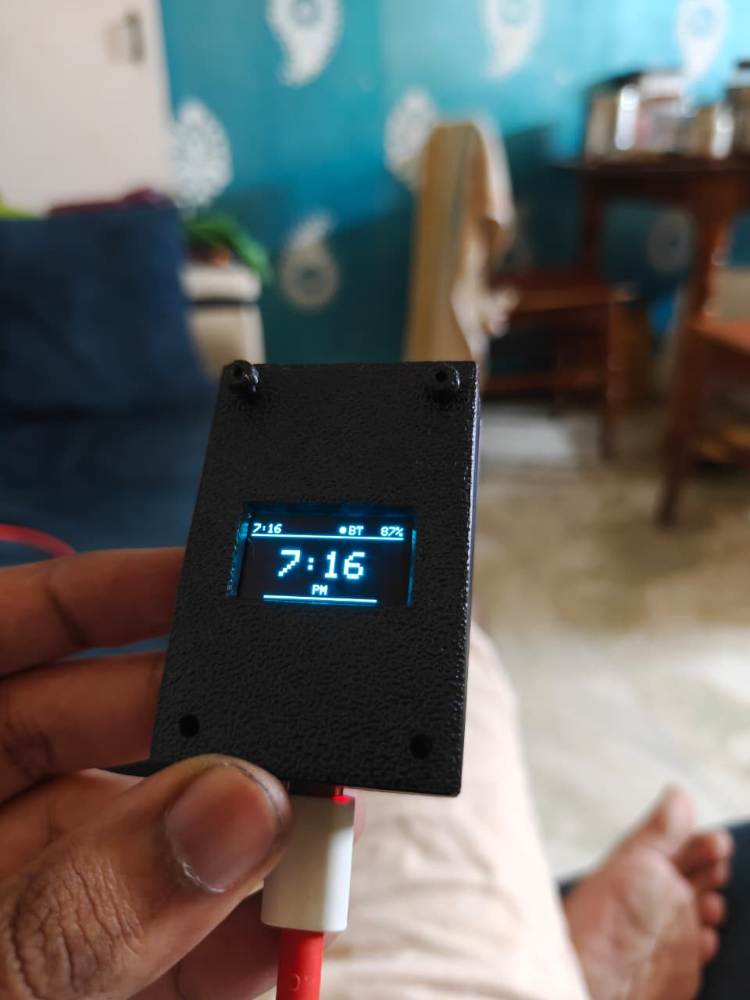

# Bike HUD

**A minimalist, BLE-powered heads-up display for bicycle and motorcycle handlebars.**


-green)

Bike HUD shows the time, phone battery, turn-by-turn navigation, notifications, and incoming calls on a compact 0.96" OLED mounted to your handlebar. All data comes from your Android phone over Bluetooth Low Energy via the [Chronos](https://chronos.ke) app. There is no Wi-Fi, no web server, and no cloud dependency.


---

## Table of Contents

- [Features](#features)
- [Hardware](#hardware)
- [Wiring](#wiring)
- [Software Setup](#software-setup)
- [Chronos App Setup](#chronos-app-setup)
- [Usage](#usage)
- [Screen Reference](#screen-reference)
- [3D-Printed Enclosure](#3d-printed-enclosure)
- [Firmware Design Notes](#firmware-design-notes)
- [Troubleshooting](#troubleshooting)
- [Safety](#safety)
- [Contributing](#contributing)
- [License](#license)
- [Acknowledgements](#acknowledgements)

---

## Features

| Feature | Description |
|---------|-------------|
| **Clock** | 12/24-hour format is controlled exclusively by the phone through Chronos. The firmware never forces a format. |
| **Phone battery** | Shows the connected phone's battery percentage and charging state. |
| **Navigation** | Turn icon and text directions while a route is active on the phone. |
| **Notifications** | Full-screen alert when idle; a compact toast in the bottom-right corner while navigating. |
| **Incoming calls** | Pulsing full-screen alert with the caller's name, or a compact banner while navigating. The display prompts you to answer on your phone. |
| **Missed calls** | Recognized phone notifications are labelled "MISSED CALL". |
| **Throttled rendering** | Display updates are limited to about 15 FPS and occur when state changes or an animation needs a frame. |
| **Stale-call timeout** | A ringing screen clears after 2 minutes if no call-ended event arrives. |
| **Text sanitising** | Unicode arrows and symbols from navigation apps are mapped to ASCII equivalents the SSD1306 font can render. |

---

## Hardware

| Qty | Component | Notes |
|-----|-----------|-------|
| 1 | ESP32-C3 SuperMini development board | [Robu.in listing](https://robu.in/product/esp32-c3-development-board-with-soldering/). Confirm that header pins are fitted or included before ordering. |
| 1 | 0.96" I²C OLED, 128×64, SSD1306, 4-pin | [Robu.in listing](https://robu.in/product/4pin-oled-display-module-blue/) |
| 1 | 3D-printed enclosure and handlebar mount | See [3D-Printed Enclosure](#3d-printed-enclosure). |
| 4 | M3 × 8 mm screws (M3 × 6 mm also works) | For fastening the enclosure parts. Confirm against your final STL set. |
| 4 | Female-to-female jumper wires | Or solder directly for a more vibration-resistant build. |
| 1 | USB-C cable | Programming and power. |

The ESP32-C3 SuperMini handles the BLE connection and OLED graphics. Board dimensions and pin labels can vary by manufacturer; check your specific board before wiring.

---

## Wiring

| OLED pin | ESP32-C3 pin |
|----------|--------------|
| VCC | 3V3 |
| GND | GND |
| SCL | GPIO 21 |
| SDA | GPIO 20 |

```
ESP32-C3 SuperMini            0.96" OLED
──────────────────            ──────────
3V3     ───────────────────►  VCC
GND     ───────────────────►  GND
GPIO 21 ───────────────────►  SCL
GPIO 20 ───────────────────►  SDA
```

> **Pin note:** The firmware initializes I²C with GPIO 20 (SDA) and GPIO 21 (SCL). If you use different pins, update `Wire.begin()` in the sketch to match.

> **Power the OLED from 3V3, not 5V.** Many OLED modules accept 5 V on VCC, but their I²C pull-up resistors are then tied to that rail. The ESP32-C3's GPIOs are 3.3 V only, so a 5 V pull-up can stress or damage the pins.

---

## Software Setup

### 1. Install the Arduino IDE

Install Arduino IDE 2.x from [arduino.cc](https://www.arduino.cc/en/software).

### 2. Add ESP32 board support

1. Open **File → Preferences**.
2. Add the following URL to **Additional Boards Manager URLs**:
   ```
   https://raw.githubusercontent.com/espressif/arduino-esp32/gh-pages/package_esp32_index.json
   ```
3. Open **Tools → Board → Boards Manager**, search for `esp32`, and install **esp32 by Espressif Systems**.

### 3. Install libraries

Open **Tools → Manage Libraries** and install:

| Library | Author | Purpose |
|---------|--------|---------|
| Adafruit SSD1306 | Adafruit | OLED driver |
| Adafruit GFX Library | Adafruit | Graphics primitives |
| ChronosESP32 | Felix Biego | BLE link to the Chronos app |
| NimBLE-Arduino | h2zero | BLE stack used by ChronosESP32 (normally installed as a dependency) |

ChronosESP32 source: [github.com/fbiego/chronos-esp32](https://github.com/fbiego/chronos-esp32).

### 4. Configure the board

| Setting | Value |
|---------|-------|
| Board | **ESP32C3 Dev Module** |
| USB CDC On Boot | **Enabled** (required for Serial output over USB) |
| Port | The port that appears when the board is connected |

### 5. Upload

1. Open [`code/BikeHUD_Chronos_NavCall.ino`](code/BikeHUD_Chronos_NavCall.ino) in the Arduino IDE.
2. Click **Upload**.

If the upload fails, hold the **BOOT** button while connecting the board over USB to enter the bootloader, then try again.

---

## Chronos App Setup

1. Install **Chronos** on your Android phone from the [Chronos website](https://chronos.ke/app?id=esp32) or the Google Play Store.
2. Open the app and add a new watch/device, choosing the **ESP32** option.
3. Select the HUD from the scan list. It advertises under the name set in the firmware:
   ```cpp
   ChronosESP32 watch("EN NE");
   ```
   Change this string to rename the device.
4. Grant Chronos **Notification Access** in Android settings so alerts can be forwarded.
5. Allow Chronos to run in the background (exclude it from battery optimisation) so the connection stays alive while riding.

> **Clock format:** The 12/24-hour setting is read from the phone via Chronos. Do not call `watch.set24Hour()` in the firmware.

---

## Usage

1. Power the HUD over USB-C from a power bank or your vehicle's USB supply.
2. Open Chronos and confirm the HUD shows as connected.
3. Start a route in a navigation app supported by Chronos. The HUD switches to the navigation screen when it receives navigation data.
4. Notifications appear for about 5 seconds. Incoming-call alerts clear when an end event arrives, the BLE connection drops, or the 2-minute fallback timeout expires.

---

## Screen Reference

| State | Display |
|-------|---------|
| **Idle (clock)** | Large time, meridiem, Bluetooth indicator, phone battery, decorative underline. |
| **Navigating** | Status bar on top, turn icon on the left, up to five lines of directions on the right. |
| **Notification (idle)** | App name, title, message, and a shrinking progress bar showing time until auto-dismiss. |
| **Notification (navigating)** | Navigation stays visible; a toast with the app name and a one-line preview appears bottom-right. |
| **Incoming call (idle)** | Full-screen "INCOMING CALL", caller name, pulsing indicator, and a prompt to answer on the phone. |
| **Incoming call (navigating)** | Directions remain on top; the lower half shows "CALL: [name]" with a pulsing "RINGING" indicator. |
| **Missed call** | Recognized missed-call notification shows "MISSED CALL" in place of the app name. |
| **No time sync** | "SYNC WITH CHRONOS" until the first time packet arrives. |

---

## 3D-Printed Enclosure

The enclosure is a multi-part design that houses the ESP32-C3 SuperMini and the 0.96" OLED. It attaches to the handlebar with a split clamp and a 3-tab bayonet twist-lock mount, so the HUD can be removed without tools.

The repository includes these 3MF files:

- [Base.3mf](stl/Base.3mf)
- [Lid.3mf](stl/Lid.3mf)


### Print settings

| Setting | Recommendation |
|---------|----------------|
| Material | PETG (or ASA/ABS) for UV and heat resistance outdoors |
| Layer height | 0.2 mm |
| Infill | 20–30 % |
| Supports | Determine in your slicer based on print orientation and your printer's capabilities |

### Assembly

1. Fit or solder the 4-pin header to the OLED if it is not already installed.
2. Wire the OLED to the ESP32-C3 as shown in [Wiring](#wiring).
3. **Flash and test the electronics before closing the enclosure.**
4. Seat the board and display in the body, with the OLED flush against its window.
5. Route the USB-C cable through the cable exit.
6. Close the enclosure and fasten it with four M3 screws. Check the fit and required screw length against your printed parts before final assembly.
7. Fit the clamp to the handlebar, then twist-lock the HUD into the mount.

> For outdoor use, keep the USB port facing downward and consider a drip loop in the cable. The enclosure is not rated as waterproof.

---

## Firmware Design Notes

### Clock extraction

The time is read directly from Chronos so that the app stays the single source of truth for 12/24-hour format:

```cpp
String h    = String(watch.getHourC());
String t    = h + watch.getTime(":") + watch.getTime("%M");
String ampm = watch.getAmPmC(true);
```

### Overlay priority

```cpp
enum class Overlay : uint8_t { NONE, NOTIFICATION, RINGING };
```

- **RINGING** has the highest priority and overrides notifications and navigation.
- **NOTIFICATION** is full-screen when idle and a compact toast while navigating.
- **NONE** falls through to the navigation screen if a route is active, otherwise the clock.

### Stale-call timeout

The ringing overlay waits up to `CALL_STALE_MS` (120 s) for an explicit "call ended" event. If none arrives, the overlay clears itself so the HUD cannot get stuck on a ringing screen.

### Text sanitising

`cleanText()` replaces Unicode arrows and symbols commonly sent by navigation apps with ASCII equivalents before drawing.

### Throttled redraw

The display is refreshed only when `needRedraw` is set and at least `MIN_FRAME_MS` (65 ms) have elapsed since the previous frame.

---

## Troubleshooting

| Symptom | Likely cause | Fix |
|---------|--------------|-----|
| OLED stays blank | Wrong I²C address, loose wiring, or swapped SDA/SCL | Run an I²C scanner sketch. SSD1306 modules are typically at `0x3C` or `0x3D`. Re-check SDA/SCL against [Wiring](#wiring). |
| Board not detected / upload fails | Board not in bootloader mode, or USB cable/port issue | Try a USB data cable and another port. If needed, hold **BOOT** while connecting USB, then upload. USB interface hardware varies by board revision; install its driver if required by the manufacturer. |
| No Serial output | USB CDC disabled | Set **USB CDC On Boot: Enabled** and re-upload. |
| "SYNC WITH CHRONOS" stays on screen | No time data received | Open Chronos, confirm the HUD is connected, and make sure phone Bluetooth is on. |
| Notifications do not appear | Notification access not granted | Enable Notification Access for Chronos in Android settings. |
| Navigation does not appear | No active route, or the nav packet has not arrived yet | Start navigation after the HUD is connected and allow a few seconds for the first packet. |
| Connection drops while riding | Android battery optimisation is killing Chronos | Exclude Chronos from battery optimisation and allow background activity. |
| Display redraws continuously at idle | Firmware state is continually marking the display dirty | The call animation intentionally redraws while active. At idle, check for code that sets `needRedraw` unconditionally. |

---

## Safety

Do not interact with your phone while riding, and keep your attention on the road. Check local regulations on handlebar-mounted displays before use, and make sure the mount is secure and does not obstruct controls or your field of view.

---

## Contributing

Issues and pull requests are welcome. For larger changes, please open an issue first to discuss the approach. When reporting a bug, include your board, library versions, Android version, and a description of the screen state when it occurred.

---

## Acknowledgements

- [ChronosESP32](https://github.com/fbiego/chronos-esp32) by Felix Biego, the library that makes the phone link possible.
- [Adafruit SSD1306](https://github.com/adafruit/Adafruit_SSD1306) and [Adafruit GFX](https://github.com/adafruit/Adafruit-GFX-Library) for display support.
- [NimBLE-Arduino](https://github.com/h2zero/NimBLE-Arduino) by h2zero for the BLE stack.

---

